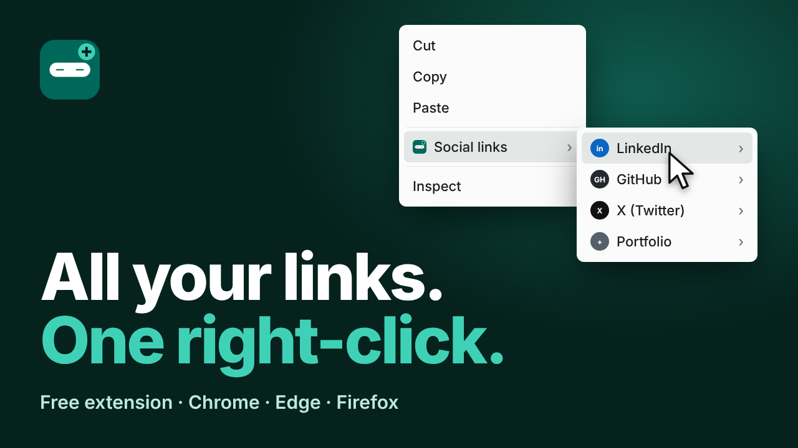

# Social Links 2.0 — browser extension

Your LinkedIn, GitHub and other profile links, one right-click away on any website: open them, copy them into a form, or add new ones. Works in Chrome, Edge, Brave, Opera, Firefox and Safari on Windows, macOS and Linux.

**Never reads or changes the websites you visit.** No host permissions, no content scripts, no analytics, no network requests.

## Demo

[](docs/demo/social-links-demo.mp4)

A 77-second walkthrough ([MP4](docs/demo/social-links-demo.mp4), [captions](docs/demo/social-links-demo.en.srt)): copy and open links from the right-click menu, save a link by right-clicking it, the toolbar panel, profiles, the share card and backup. The source that renders it is in [`docs/demo/source`](docs/demo/source).

## Features

- **Right-click menu everywhere** — open or copy any saved link; add the link, page or text you right-clicked; add or edit any platform; switch profile.
- **Built-in platforms** — LinkedIn, GitHub, X, Instagram, YouTube, Facebook, TikTok, Medium, DEV, Stack Overflow, Website, Email — plus **Other link** for any site under your own name, as many as you like.
- **Smart detection** — right-click a GitHub repo, a LinkedIn post or a YouTube video and it saves the owner's profile. Unknown sites become an Other link named after the site.
- **+ and ✎** — platforms you haven't added show **+**; ones you have show **✎** and open for editing. One link per platform, so you never get duplicates.
- **Profiles** — separate sets such as Work and Personal; create, rename, delete and switch from the popup or the menu.
- **Share card** — a QR code that phones scan straight into contacts, plus a downloadable vCard (.vcf).
- **Backup and restore** — export everything to a JSON file; import with a preview, then merge or replace.
- **Everyday polish** — search once you have more than 10 links, drag or keyboard reordering, Undo after remove, Copy all / Copy JSON, Alt+Shift+L shortcut, light and dark mode, high-contrast support, full keyboard and screen-reader support.
- **Syncs** through your browser account; if you outgrow the sync quota it saves on this computer instead and tells you.

## Right-click menu

| Where you right-click | What *Social links* offers |
|---|---|
| Anywhere | Each saved link › **↗ Open** / **⧉ Copy** (email: copy only) · **+ Add / ✎ Edit ›** each platform · **Profile ›** switch · **Manage links…** |
| On a link | **+ Add / ✎ Edit › + Add this link** |
| On empty page space | **+ Add / ✎ Edit › + Add this page** |
| On selected text | **+ Add / ✎ Edit › + Add "…"** (a URL, domain or email address) |

Toolbar badge after a menu action: **✓** added · **✎** updated · **⧉** copied · **=** already saved · **!** not a valid link.

## Install

Two ready-built folders are in `dist/` (zips alongside):

| Browser | Folder |
|---|---|
| Chrome, Edge, Brave, Opera, Vivaldi; Safari via converter | `dist/chromium` |
| Firefox 121+ | `dist/firefox` |

**Chrome / Edge / Brave / Opera**
1. Open `chrome://extensions` (Edge: `edge://extensions`), turn on **Developer mode**.
2. **Load unpacked** → choose `dist/chromium`.
3. Pin it from the puzzle-piece menu.

*Upgrading from 1.0:* Chrome ties an unpacked extension's saved data to its folder. Copy the contents of `dist/chromium` **into your existing `social-links-ext` folder** (replace everything) and press **Reload** on the extensions page — your links move into the Work profile automatically. Loading from a new folder starts empty.

**Firefox**
- Try it: `about:debugging#/runtime/this-firefox` → **Load Temporary Add-on…** → `dist/firefox/manifest.json` (removed when Firefox restarts).
- Keep it: `npm run firefox:sign` (needs free addons.mozilla.org API keys) gives a signed .xpi you can install permanently; or publish it (see `store/PUBLISHING.md`).

**Safari (macOS)**
```
xcrun safari-web-extension-converter dist/chromium --app-name "Social Links"
```
Open the generated Xcode project, **Run**, then enable it in Safari › Settings › Extensions (for local testing also turn on *Allow unsigned extensions* in the Develop menu). Not tested here — see below.

## Permissions

| Permission | Browser | Why | Install warning |
|---|---|---|---|
| `contextMenus` / `menus` | all | the right-click menu | none |
| `storage` | all | save your links (browser sync, local fallback) | none |
| `offscreen` | Chrome/Edge | a hidden extension page that performs **Copy** from the menu | none |
| `clipboardWrite` | all | write (never read) the clipboard for **Copy** | "Modify data you copy and paste" |
| `favicon` *(optional, off by default)* | Chrome/Edge | real site icons for Other links — only if you click **Show site icons** | "Read the icons of the websites you visit" |

Chrome reports exactly one install warning for this extension: *Modify data you copy and paste* (verified with `chrome.management.getPermissionWarningsByManifest`). The extension cannot read your clipboard, your tabs, your history or any page content.

## Develop

```
npm run build        # dist/chromium, dist/firefox + zips
npm test             # unit tests + simulated-Firefox background test
npm run test:qr      # QR encoder round-trip, decoded by OpenCV (python3 + opencv)
npm run test:e2e     # loads dist/chromium in real Chrome with Playwright
```
Source is in `src/` (plain JavaScript, no build step, no dependencies); `manifests/` holds the per-browser manifests; strings are in `src/_locales/en/messages.json` — copy that folder to e.g. `_locales/fr/` to translate.

## Testing status (v2.0.0)

| Check | Result |
|---|---|
| Unit tests: URL parsing, validation, vCard, storage fallback, v1 migration, backup cleaning/merge, QR | 9/9 pass |
| QR encoder decoded by OpenCV (versions 1–19, levels M and L, incl. Unicode) | 20/20 pass |
| Real Chrome (Playwright, unpacked extension): permissions and install warnings, menu structure, add/update/copy/open from the menu, stale-ID safety, profile switching, popup add/edit/validate, + and ✎ tiles, keyboard reorder, remove/undo, search, profiles, share card + vCard + QR image, backup/restore with preview, deep links, accessibility names | 47/47 pass |
| Simulated Firefox background (fake `browser` API) | pass |

**Not tested:**
- **Real Firefox and Safari.** Neither was available in the build environment. Run `npm run firefox:lint` and `npm run firefox:run` to check Firefox.
- **Clicking the native right-click menu itself.** Browsers don't let automation open their own menus, so the tests call the same handler the menu uses and check the menu that was built.
- **Phone scanning of the QR code.** Large cards (around 15+ links) produce dense codes; the popup warns and suggests the vCard instead.
